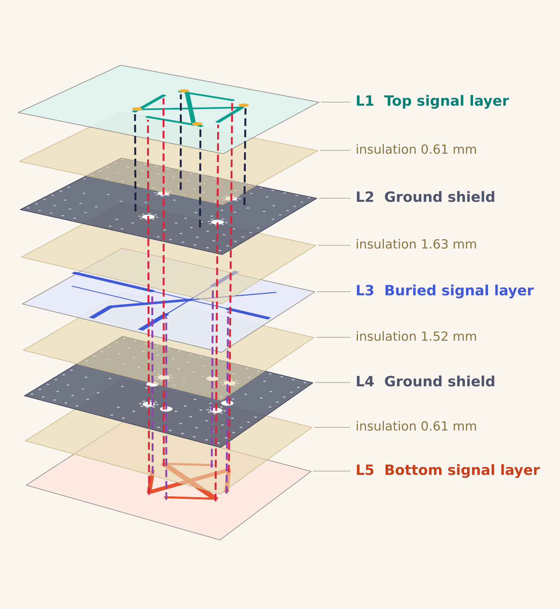
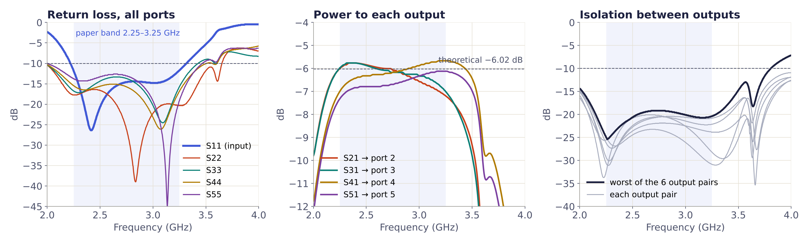
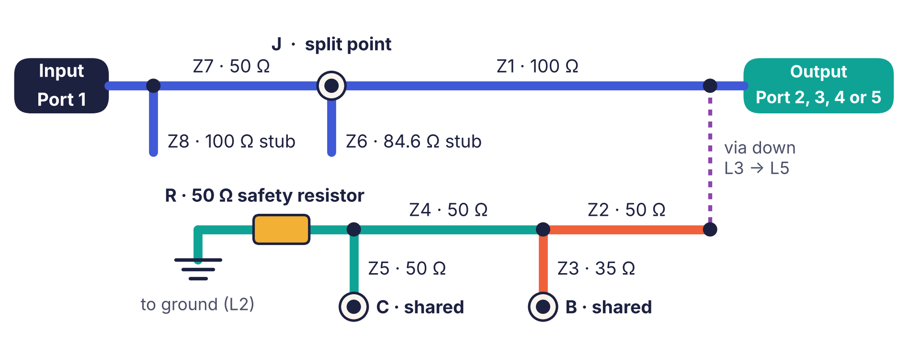
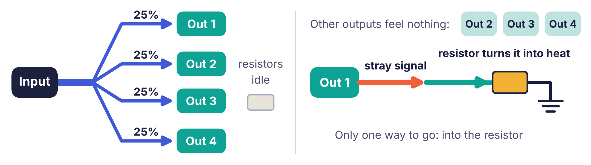
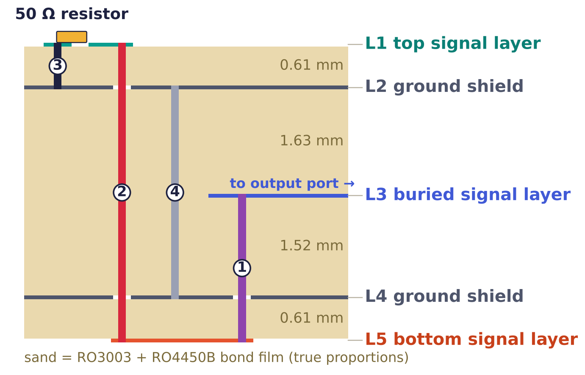
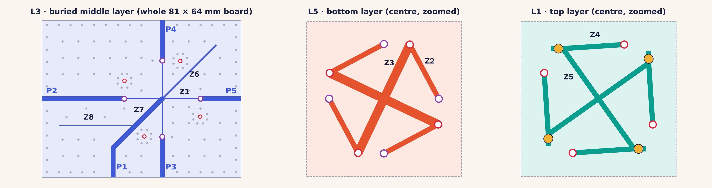

# Broadband 4-Way Equal Power Divider (Knochel-Mayer, 5-layer PCB) — CST Design & Simulation

Design and full-wave simulation of a broadband, equal-split, in-phase **4-way Knochel-Mayer power divider/combiner**
centred at **2.75 GHz** (S-band). It is built on a 5-layer microstrip/stripline board with vertical via interconnects,
following Furgal *et al.*, EuMC 2020 (see [Reference](#reference)).

The whole 3-D model is generated by one **CST Studio Suite VBA macro**: stack-up, three signal layers, ground planes,
144 vias, isolation resistors and 5 ports, fully parametric.

**Authors:** Devansh Dusad, Prateek Panjikar, BITS Pilani, K K Birla Goa Campus



---

## Headline results (CST, 2–4 GHz)

| Metric | Paper (measured prototype) | This work (CST) |
|---|---|---|
| Working band (S11 < −10 dB) | 2.25–3.25 GHz | **2.22–3.32 GHz** |
| Fractional bandwidth | > 30 % | **40 %** |
| Power to each output at 2.75 GHz | about −6 to −8 dB | **−6.1 to −6.7 dB** (ideal −6.02 dB) |
| Amplitude balance | ±2 dB | **0.6 dB** at 2.75 GHz, 1.5 dB worst in band |
| Isolation between outputs, 2.25–3.25 GHz | > 10 dB | **> 19 dB** |
| Phase balance | ±5° | not yet reported (see [Limitations](#limitations)) |



At 2.75 GHz: S21 = −6.09 dB, S31 = −6.17 dB, S41 = −6.16 dB, S51 = −6.69 dB. The deepest input match is
**−26.4 dB at 2.416 GHz**. The −10 dB band is centred near 2.77 GHz, so the design is on frequency; the dip simply sits
low in the band. Retuning the λ/2 stubs Z6 and Z8 (parameters `Lstub6`, `Lstub8`) moves it.

The paper's figures are measured on a real board with connectors, tolerances and copper loss. This model uses its own
floor plan and lossless metal, so the two are not expected to match exactly.

---

## Circuit



| Line | Z (Ω) | Electrical length | Layer | Role |
|---|---|---|---|---|
| Z1 (×4) | 100 | λ/4 | L3 stripline | Main split: transforms 50 Ω to 200 Ω, four in parallel give 50 Ω |
| Z2 (×4) | 50 | λ/4 | L5 microstrip | Output to shared node B |
| Z3 (×4) | 35 | λ/4 | L5 microstrip | Ties each branch to centre point B |
| Z4 (×4) | 50 | λ/4 | L1 microstrip | Path to the isolation resistor |
| Z5 (×4) | 50 | λ/4 | L1 microstrip | Ties each resistor to shared point C |
| R (×4) | 50 | — | L1, via to L2 ground | Absorbs odd-mode power; heat-sunk through a via |
| Z7 | 50 | λ/4 | L3 stripline | Input section |
| Z6 | 84.6 | λ/2 open stub | L3 stripline | Broadbanding stub |
| Z8 | 100 | λ/2 open stub | L3 stripline | Broadbanding stub |



**Even mode** (normal operation): all outputs are in phase, no current flows into the resistor network, and the four
Z1 quarter-wave transformers (Z1 = √(50·200) = 100 Ω) match the input. **Odd mode** (power reflected from one output):
the shared points act as virtual grounds and the unwanted signal is dumped in the 50 Ω resistors, which isolates the outputs.

---

## Board



| Layer | Contents |
|---|---|
| L1, top microstrip | Z4, Z5, four 50 Ω resistors |
| L2, ground | Solid plane with via clearances |
| L3, buried stripline | Z1 ×4, Z6, Z7, Z8 and all five port feeds |
| L4, ground | Solid plane with via clearances |
| L5, bottom microstrip | Z2 ×4, Z3 ×4 |

* **Dielectrics:** Rogers RO3003 (εr 3.00, tan δ 0.0013), 20 mil outer and 60 mil cores, bonded with RO4450B (εr 3.54, tan δ 0.004), 4 mil.
* **Thickness:** 4.47 mm total, 35 µm copper. **Board size:** 81 × 64 mm.
* **Vias:** 144 in total. 4 run L1–L5, 4 run L3–L5, 4 tie the resistors to ground (L1–L2), and 132 stitch the grounds (L2–L4).
  Via radius 0.4 mm, pad 0.8 mm, antipad 1.4 mm.



### Line dimensions (2-D field solution of this exact stack-up at 2.75 GHz)

| Line type | Z (Ω) | Width (mm) | εeff | λ/4 length (mm) |
|---|---|---|---|---|
| Microstrip (L1/L5) | 50 | 1.459 | 2.44 | 17.46 |
| Microstrip (L5) | 35 | 2.483 | 2.56 | 17.05 |
| Stripline (L3) | 50 | 1.924 | 3.04 | 15.64 |
| Stripline (L3) | 100 | 0.363 | 3.07 | 15.55 (λ/2 stub: 31.09) |
| Stripline (L3) | 84.6 | 0.610 | 3.06 | λ/2 stub: 31.16 |

The paper gives no layout dimensions. The floor plan here is original: it keeps the paper's topology, layer assignment,
via scheme and stack-up. The four Z1 lines run along the axes and the input enters diagonally. Ports: P1 input (bottom
edge), P2 west, P3 south, P4 north, P5 east, all on L3.

---

## Repository layout

```
cst/KM4_divider_CST.bas          CST VBA macro that builds the complete parametric model
results/screenshots/Sxy.png      CST result plots, one per S-parameter, plus an overlay of all curves
results/sparams_traced.csv       Magnitudes (dB) traced from those plots, 2–4 GHz, 5 MHz step
figures/                         Circuit, stack-up, exploded view, layer layouts, results summary
docs/presentation.pdf / .pptx    Project presentation
```

## Reproducing the simulation

1. CST Studio Suite: **File → New and Recent → New project**, an empty template is fine.
2. **Home → Macros → Run Macro…** and select `cst/KM4_divider_CST.bas`. Run it **once** in an empty project.
   Every step goes into the History List, so the model rebuilds when you edit a parameter.
3. Check **Simulation → Setup Solver**: time-domain solver, S-parameters normalised to 50 Ω. The macro already sets
   2–4 GHz, open boundaries and five waveguide ports on L3.
4. **Start** the simulation. Results appear under *1D Results → S-Parameters*.

The main parameters (all editable in the Parameter List) are `W_ms50`, `W_ms35`, `W_sl50`, `W_sl100`, `W_sl85` (line widths),
`Lstub6` and `Lstub8` (stub lengths, the main tuning knobs), `R_iso` (resistor value), the via radii, and the layer thicknesses
`h_sub`, `h_bond`, `h_core` and `t_cu`.

## Limitations

* **`results/sparams_traced.csv` is traced from the screenshots, not exported from CST.** Expect about 0.1 dB error; it was
  checked against the CST marker values at 2.416 GHz. Where a marker label covered a curve, the gap was filled from the
  reciprocal curve (Sij = Sji, since the circuit is passive and reciprocal). S13 and S53 were not plotted.
* **Phase is not available**, so phase balance is not reported. To add it, export a Touchstone file (*Post-Processing →
  Import/Export → Touchstone*, 5 ports) to `results/KM4_divider.s5p`. That replaces the traced CSV.
* The simulation uses lossless (PEC) metal. Copper loss and a fabricated prototype are future work.

## Next steps

- Tune Z6/Z8 to centre the deepest match at 2.75 GHz
- Re-run with finite-conductivity copper
- Fabricate and measure on a VNA

## Reference

J. Furgal, K. Xu, J. H. Choi and J. K. Lee, "Broadband Equal-Split Planar 4-Way Power Divider/Combiner Suitable for
High Power Applications," *2020 50th European Microwave Conference (EuMC)*, Utrecht, 2021.
doi: [10.23919/EuMC48046.2021.9337968](https://doi.org/10.23919/EuMC48046.2021.9337968)

The paper itself is not included in this repository (copyright IEEE/EuMA).

## License

* Code (`cst/`): [MIT](LICENSE)
* Figures, screenshots, data and slides (`figures/`, `results/`, `docs/`): [CC BY 4.0](https://creativecommons.org/licenses/by/4.0/)
